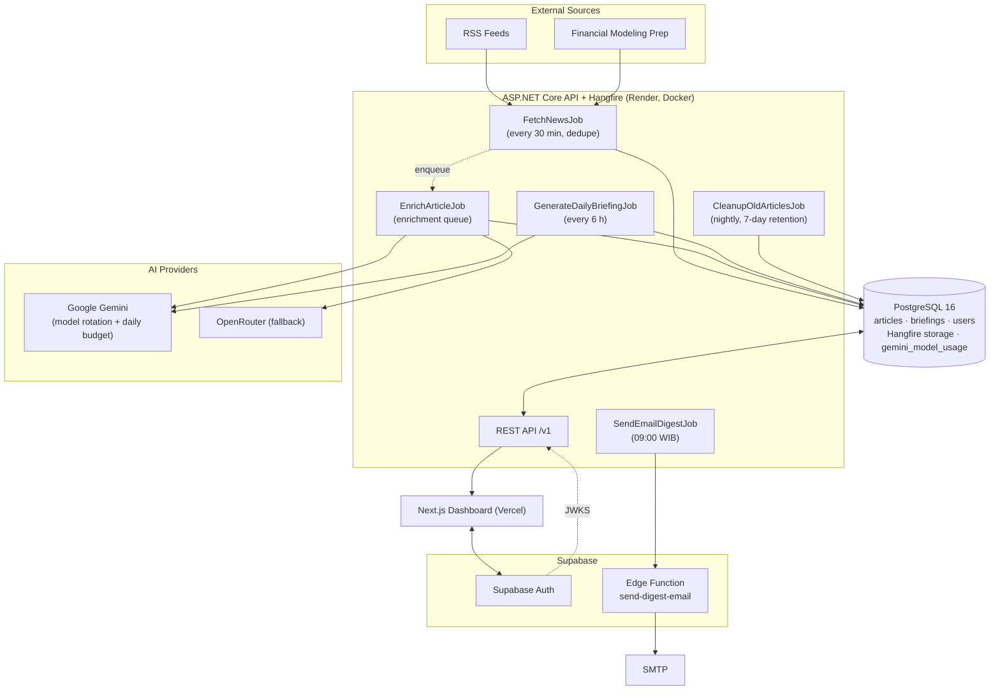

# Arunika

> **The First Light of Market Intelligence**

Arunika ingests financial news from RSS feeds and Financial Modeling Prep and turns each article into structured, decision-ready intelligence — a summary, topic classification, sentiment, a market-impact score, affected sectors, and keywords. The highest-impact stories of a rolling seven-day window are rolled into a briefing with an AI-written executive summary, shown on the dashboard and sent as a daily email digest.

[](https://github.com/cemielan/arunika/actions/workflows/ci.yml)
[](https://github.com/cemielan/arunika/actions/workflows/cd.yml)
[](https://opensource.org/licenses/MIT)
[](https://dotnet.microsoft.com/)
[](https://nextjs.org/)
[](https://www.postgresql.org/)

---

## Features

- **News ingestion** every 30 minutes from 9 active RSS feeds (Federal Reserve, WSJ Markets, BBC Business, Antara Ekonomi, CNBC, MarketWatch, CNBC Indonesia, Kontan, Detik Finance) plus Financial Modeling Prep.
- **Deduplication** by a title + source hash, backed by a PostgreSQL trigram index on titles.
- **AI enrichment** with Google Gemini structured output: summary, category, sentiment, impact score, sector impacts, keywords. OpenRouter acts as the fallback provider (or the primary one, via `AI:PreferredProvider`).
- **Gemini free-tier budgeting**: rotation across a chain of Flash / Flash-Lite models, per-model RPM/RPD quotas derated by a safety margin, a circuit breaker, and a per-model daily call count persisted in PostgreSQL (`gemini_model_usage`) so the budget survives redeploys and is shared across instances.
- **Briefing**: top 10 stories by impact score over a rolling 7-day window, with an AI executive summary, sentiment and risk level. Generated every 6 hours, or on demand when today's briefing is missing.
- **Email digest** daily at 09:00 WIB, delivered through a Supabase Edge Function over SMTP.
- **Auth** via Supabase Auth (sign up, email verification, password reset) in the dashboard; the API validates Supabase-issued JWTs.
- **Rate limiting** per client IP: 100 req/min globally, 10 req/min on `/v1/briefing`.
- **Retention**: articles older than 7 days are deleted nightly.
- **PWA**: web app manifest, service worker and offline page.

---

## Architecture Overview



### How the impact score works

Every enriched article carries an impact score from 0 to 100, and the briefing
is the ten highest-scoring stories from a rolling seven-day window.

The score is not a single judgement call by the model. The model rates five
components against a shared rubric, and the score is their sum, computed in
application code:

| Component | Range | What it measures |
|-----------|-------|------------------|
| `breadth` | 0–25 | How much of the market the news touches |
| `magnitude` | 0–25 | Plausible size of the resulting price move |
| `surprise` | 0–20 | How much was not already priced in |
| `immediacy` | 0–15 | How soon the effect arrives |
| `certainty` | 0–15 | How firm the news is — confirmed, or a rumour |

Splitting the judgement this way is what keeps the scale usable. Asked for a
bare 0–100 number, models answer in multiples of 5, which turns a 100-point
scale into about 20 values and leaves the top stories tied with each other.

The rubric lives in `ImpactScoringRubric` and is sent verbatim by every
provider, so scores stay comparable across model rotation and provider
fallback. Full rationale and band anchors are in
[the design doc, §5](Arunika-Application-Design.md).

### Background jobs (Hangfire, Asia/Jakarta time)

| Job | Schedule | Queue |
|-----|----------|-------|
| `FetchNewsJob` | `*/30 * * * *`, plus once on startup | `fetch` |
| `EnrichArticleJob` | Enqueued per new, non-duplicate article | `enrichment` |
| `RetryFailedEnrichmentJob` | `0 * * * *` (hourly) | `enrichment` |
| `GenerateDailyBriefingJob` | `0 */6 * * *` | `default` |
| `SendEmailDigestJob` | `0 9 * * *` | `default` |
| `CleanupOldArticlesJob` | `20 0 * * *` | `default` |

Hangfire uses PostgreSQL storage, so no extra infrastructure is needed.

### Tech Stack

| Layer | Technology |
|-------|------------|
| **Backend API** | ASP.NET Core (.NET 10), Clean Architecture, Serilog, Swashbuckle |
| **Database** | PostgreSQL 16 + EF Core 10 (Npgsql) |
| **Scheduler** | Hangfire 1.8 + Hangfire.PostgreSql |
| **AI Enrichment** | Google Gemini via `Google.GenAI` (structured output); OpenRouter fallback |
| **Resilience** | Polly, custom Gemini rate limiter + circuit breaker |
| **News Sources** | RSS (`System.ServiceModel.Syndication`) + Financial Modeling Prep |
| **Frontend** | Next.js 16 (App Router), React 19, Tailwind CSS 4, HeroUI 3, Framer Motion |
| **Auth** | Supabase Auth (frontend `@supabase/supabase-js`); API validates Supabase JWTs via JWKS |
| **Email** | Supabase Edge Function (Deno + nodemailer) over SMTP |
| **Tests** | xUnit, Testcontainers (PostgreSQL), `WebApplicationFactory` |
| **Deployment** | Backend: Render (Docker) · Frontend: Vercel |
| **CI/CD** | GitHub Actions |

---

## Quick Start

### Prerequisites

- [.NET 10 SDK](https://dotnet.microsoft.com/download/dotnet/10.0)
- [Node.js](https://nodejs.org/) 24 (the version CI uses) + npm
- [Docker Desktop](https://www.docker.com/products/docker-desktop/) — local PostgreSQL and integration tests
- A [Supabase](https://supabase.com/) project — auth (required by the API at startup) and email
- [Gemini API Key](https://aistudio.google.com/apikey)
- Optional: [Financial Modeling Prep API Key](https://site.financialmodelingprep.com/developer/docs), [OpenRouter API Key](https://openrouter.ai/)

### 1. Clone & Start Infrastructure

```bash
git clone https://github.com/cemielan/arunika.git
cd arunika

# Start PostgreSQL 16 (db/user: arunika, local dev password from docker-compose.yml)
docker-compose up -d
```

### 2. Configure Backend Secrets

```bash
cd backend/src/Arunika.Api

dotnet user-secrets set "ConnectionStrings:DefaultConnection" "Host=localhost;Port=5432;Database=arunika;Username=arunika;Password=<local-dev-password>"
dotnet user-secrets set "Supabase:Url" "https://<project-ref>.supabase.co"
dotnet user-secrets set "Gemini:ApiKey" "<your-gemini-api-key>"

# Optional
dotnet user-secrets set "FinancialModelingPrep:ApiKey" "<your-fmp-api-key>"
dotnet user-secrets set "OpenRouter:ApiKey" "<your-openrouter-api-key>"
dotnet user-secrets set "Email:EdgeFunctionSecret" "<shared-secret-matching-SEND_SECRET>"
dotnet user-secrets set "Admin:TriggerKey" "<random-admin-key>"

cd ../../..
```

### 3. Run Backend API

```bash
cd backend
dotnet run --project src/Arunika.Api
```

Pending EF Core migrations are applied automatically on startup. To apply them manually:

```bash
dotnet ef database update --project src/Arunika.Infrastructure --startup-project src/Arunika.Api
```

**Backend URLs:**
- API: `http://localhost:5097`
- Swagger: `http://localhost:5097/swagger` (Development only)
- Hangfire Dashboard: `http://localhost:5097/hangfire` (Development only)
- Health Check: `http://localhost:5097/health`

### 4. Run Frontend Dashboard

```bash
# In a new terminal
cd frontend/arunika-dashboard
npm install
npm run dev
```

Create `frontend/arunika-dashboard/.env.local`:

```env
NEXT_PUBLIC_API_BASE_URL=http://localhost:5097
NEXT_PUBLIC_SUPABASE_URL=https://<project-ref>.supabase.co
NEXT_PUBLIC_SUPABASE_ANON_KEY=<supabase-anon-key>
# Optional: public site URL, otherwise the runtime origin is used
NEXT_PUBLIC_SITE_URL=http://localhost:3000
```

**Frontend URL:** `http://localhost:3000`

### 5. Stop Services

```bash
docker-compose down
```

---

## Configuration

### Backend (`appsettings.json` / user-secrets / environment variables)

Use `__` instead of `:` for environment variables (e.g. `Gemini__ApiKey`).

| Key | Required | Description |
|-----|----------|-------------|
| `ConnectionStrings:DefaultConnection` | Yes | PostgreSQL connection string (app data + Hangfire + Gemini usage) |
| `Supabase:Url` | Yes | Supabase project URL — JWT authority and Edge Function base URL |
| `Gemini:ApiKey` | Yes* | Gemini API key |
| `Gemini:Model`, `Gemini:FallbackModels`, `Gemini:ModelQuotas`, `Gemini:MaxRequestsPerMinute`, `Gemini:QuotaSafetyPercent`, `Gemini:ArticlesPerRotation` | No | Model chain and free-tier quota tuning (defaults in `GeminiOptions` / `appsettings.json`) |
| `OpenRouter:ApiKey`, `OpenRouter:Model`, `OpenRouter:FallbackModels` | No | Fallback AI provider |
| `AI:PreferredProvider` | No | `Gemini` (default) or `OpenRouter` |
| `FinancialModelingPrep:ApiKey` | No | FMP news source |
| `Email:EdgeFunctionSecret` | For email | Shared secret sent as `x-send-secret`; must equal the function's `SEND_SECRET` |
| `Email:EdgeFunctionName`, `Email:FromName`, `Email:FrontendUrl` | No | Digest email settings |
| `Admin:TriggerKey` | No | Enables `/v1/admin/*` endpoints (disabled with 503 when empty) |
| `Cors:FrontendOrigin` | No | Allowed CORS origin (default `http://localhost:3000`) |

\* At least one AI provider key is needed for enrichment.

### Supabase Edge Function secrets (`send-digest-email`)

`SEND_SECRET`, `SMTP_HOST`, `SMTP_PORT`, `SMTP_USER`, `SMTP_PASS`, `SMTP_FROM_EMAIL`, `SMTP_FROM_NAME`

---

## Project Structure

```
arunika/
├── backend/
│   ├── src/
│   │   ├── Arunika.Domain/          # Entities, enums — zero external deps
│   │   ├── Arunika.Application/     # Abstractions, constants, services (briefing, dedupe)
│   │   ├── Arunika.Infrastructure/
│   │   │   ├── AI/                  # Gemini + OpenRouter, rate limiter, usage store, rubric
│   │   │   ├── Auth/                # Supabase options
│   │   │   ├── BackgroundJobs/      # Hangfire jobs + recurring job registration
│   │   │   ├── Email/               # Edge Function email client
│   │   │   ├── News/                # RSS + Financial Modeling Prep fetchers
│   │   │   └── Persistence/         # EF Core DbContext, configurations, migrations, repositories
│   │   └── Arunika.Api/             # Controllers, middleware, rate limiting, Program.cs
│   ├── tests/
│   │   ├── Arunika.UnitTests/
│   │   └── Arunika.IntegrationTests/  # Testcontainers PostgreSQL (needs Docker)
│   ├── Dockerfile
│   └── Arunika.slnx
├── frontend/
│   └── arunika-dashboard/           # Next.js 16 App Router
│       ├── src/
│       │   ├── app/                 # Briefing, news, article, sectors, auth pages
│       │   ├── components/          # React components
│       │   └── lib/                 # API client, Supabase client, auth context
│       └── public/                  # Icons, service worker, offline page
├── supabase/
│   ├── config.toml
│   ├── deploy-edge-function.ps1     # Sets function secrets and deploys it
│   └── functions/send-digest-email/ # Edge Function (Deno) that sends email via SMTP
├── docker-compose.yml               # PostgreSQL 16 for local dev
├── .github/
│   ├── dependabot.yml
│   └── workflows/
│       ├── ci.yml                   # Backend build + test, frontend lint + build
│       └── cd.yml                   # Deploy to Vercel + Render
├── LICENSE
├── CONTRIBUTING.md
├── SECURITY.md
├── CHANGELOG.md
└── README.md
```

---

## API Endpoints (v1)

| Endpoint | Description |
|----------|-------------|
| `GET /v1/news` | Paginated feed. Query: `category`, `search` (full-text), `from`, `to`, `sortBy` (`date` \| `impact`), `page`, `pageSize` (max 100) |
| `GET /v1/articles/{id}` | Full article detail: summary, sentiment, impact rationale, sectors, keywords |
| `GET /v1/briefing?date=YYYY-MM-DD` | Briefing for the 7-day window ending on `date` (default: today, WIB) — executive summary, top stories, market pulse |
| `GET /v1/sectors` | Sector impact aggregation over the last 7 days |
| `GET /v1/users/me` | Current user's profile (Supabase JWT required) |
| `POST /v1/users/me` | Create/update the profile from the Supabase JWT claims |
| `POST /v1/admin/jobs/fetch-news` | Enqueue a fetch run (`X-Admin-Key`) |
| `POST /v1/admin/jobs/fetch-news/sync` | Run a fetch synchronously and return a report (`X-Admin-Key`) |
| `POST /v1/admin/jobs/send-digest` | Send the email digest now (`X-Admin-Key`) |
| `POST /v1/admin/email/test` | Send a test email (`X-Admin-Key`) |
| `GET /v1/admin/ai/budget` | Remaining Gemini budget and success/failure counts per model (`X-Admin-Key`) |
| `GET /health` | Health check |

**Response Envelope (success):**
```json
{ "data": { ... }, "meta": { "page": 1, "pageSize": 20, "totalItems": 134, "totalPages": 7 } }
```

**Error Envelope:**
```json
{ "error": { "code": "NOT_FOUND", "message": "Article not found" } }
```

Rate-limited requests return `429` with code `RATE_LIMITED` and a `Retry-After` header.

---

## Development

### Backend Commands

```bash
cd backend

# Build
dotnet build

# Run tests (integration tests start a PostgreSQL container — Docker must be running)
dotnet test

# Add migration
dotnet ef migrations add <Name> --project src/Arunika.Infrastructure --startup-project src/Arunika.Api

# Update database
dotnet ef database update --project src/Arunika.Infrastructure --startup-project src/Arunika.Api
```

### Frontend Commands

```bash
cd frontend/arunika-dashboard

npm run dev     # Dev server
npm run build   # Production build
npm start       # Start production server
npm run lint    # Lint
```

---

## Deployment

### CI/CD (GitHub Actions)

- **CI** (`ci.yml`, push/PR to `main`): backend restore/build/test on .NET 10; frontend `npm ci`, lint, build on Node 24.
- **CD** (`cd.yml`): push to `main` deploys to the `staging` environment, a published release deploys to `production`. Frontend via Vercel CLI (`VERCEL_TOKEN`, `VERCEL_ORG_ID`, `VERCEL_PROJECT_ID`), backend via Render deploy hooks (`RENDER_DEPLOY_HOOK_STAGING`, `RENDER_DEPLOY_HOOK_PRODUCTION`). Each deploy step is skipped with a warning when its secrets are not configured.

### Backend → Render (Docker)

1. Create a **PostgreSQL** database on Render.
2. Create a **Web Service** from this repo:
   - Root Directory: `backend`
   - Runtime: `Docker` (uses `backend/Dockerfile`, listens on `$PORT`, default 8080)
3. Set environment variables:
   | Key | Value |
   |-----|-------|
   | `ConnectionStrings__DefaultConnection` | Render Postgres connection string |
   | `Supabase__Url` | Supabase project URL |
   | `Gemini__ApiKey` | Gemini API key |
   | `OpenRouter__ApiKey` | OpenRouter API key (optional) |
   | `FinancialModelingPrep__ApiKey` | FMP API key (optional) |
   | `Email__EdgeFunctionSecret` | Same value as the Edge Function's `SEND_SECRET` |
   | `Admin__TriggerKey` | Admin key for `/v1/admin/*` (optional) |
   | `Cors__FrontendOrigin` | Frontend URL |
4. Deploy. Migrations are applied on startup.

### Frontend → Vercel

1. Import the repo in Vercel.
2. Root Directory: `frontend/arunika-dashboard`
3. Add env vars: `NEXT_PUBLIC_API_BASE_URL`, `NEXT_PUBLIC_SUPABASE_URL`, `NEXT_PUBLIC_SUPABASE_ANON_KEY`, optionally `NEXT_PUBLIC_SITE_URL`.
4. Deploy.

### Email Edge Function → Supabase

```bash
supabase link --project-ref <project-ref>
supabase secrets set SEND_SECRET=<secret> SMTP_HOST=<host> SMTP_PORT=<port> SMTP_USER=<user> SMTP_PASS=<password> SMTP_FROM_EMAIL=<from> SMTP_FROM_NAME=Arunika
supabase functions deploy send-digest-email --no-verify-jwt
```

`supabase/deploy-edge-function.ps1` scripts these steps.

---

## Mobile / PWA

The Next.js dashboard is a **Progressive Web App**:
- Web app manifest (`src/app/manifest.ts`) and install prompt — installable on Android/iOS from the browser
- Hand-written service worker (`public/sw.js`) with an offline fallback page (`public/offline.html`)
- Responsive design (Tailwind CSS)

See [Arunika-PWA-Guide.md](Arunika-PWA-Guide.md). Native app store packaging (e.g. with Capacitor) is not set up.

---

## Contributing

See [CONTRIBUTING.md](CONTRIBUTING.md) for guidelines on:
- Code style & conventions
- Pull request process
- Commit message format
- Testing requirements

---

## Security

See [SECURITY.md](SECURITY.md) for:
- Supported versions
- Reporting vulnerabilities
- Security best practices

---

## Changelog

See [CHANGELOG.md](CHANGELOG.md) for release history.

---

## License

MIT License — see [LICENSE](LICENSE) for details.

---

## Disclaimer

> Arunika provides **informational market intelligence only**, not financial or investment advice. Sentiment scores and impact ratings are AI-generated estimates. Always do your own research and consult qualified professionals before making financial decisions.

---

## Links

- [Application Design Document](Arunika-Application-Design.md)
- [Project Todo List](Arunika-Project-Todo-List.md)
- [PWA Guide](Arunika-PWA-Guide.md)
- [Frontend Dashboard README](frontend/arunika-dashboard/README.md)
